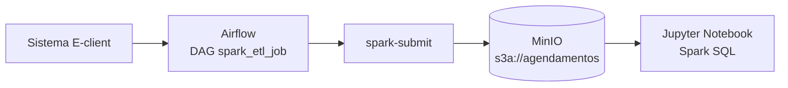
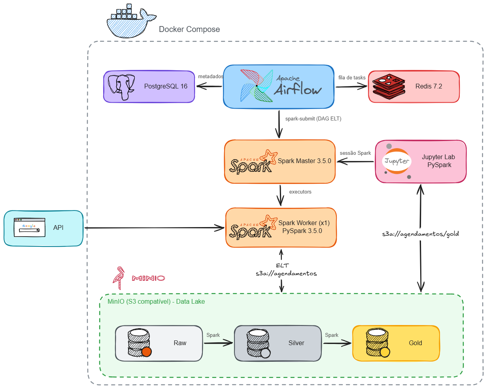

# api-hygia

Pipeline de dados que coleta os agendamentos de procedimentos do sistema **E-client** (CISBAF), processa com Spark em camadas **raw → silver → gold** e grava tudo em um **MinIO (S3)**. Os dados finais são consultados em um **Jupyter Notebook** (PySpark + Spark SQL) para alimentar os dashboards.



## Stack

| Serviço | Tecnologia | Porta (host) |
|---|---|---|
| Orquestração | Apache Airflow 3.3.1 (CeleryExecutor, FAB auth) | `8080` |
| Metadados / broker | PostgreSQL 16 + Redis 7.2 | interno |
| Processamento | Apache Spark 3.5.0 (master + 1 worker) / PySpark 3.5.0 | `8081` (UI master), `7077` |
| Data lake | MinIO (S3 compatível) | `9222` (API), `9223` (console) |
| Análise | Jupyter Lab + PySpark | `8888` |
| Orquestração de containers | Docker Compose | — |

Linguagem: Python (requests, pandas, PySpark). Os jobs Spark rodam dentro do container do Airflow (`spark-submit --master local[*]`).



## Estrutura

```
airflow/dags/validados.py            # DAG spark_etl_job
spark-apps/agendamentos/validados.py # ETL Marque Fácil (competência atual, dia 20 a dia 19)
spark-apps/agendamentos/operaAdulto.py # ETL Opera Fácil Adulto (emenda Opera Adulto SES)
notebooks/agendamentos.ipynb         # consultas no MinIO via Spark SQL
Dockerfile                           # imagem do Airflow + Java 17 + Spark 3.5.0
docker-compose.yml
env                                  # modelo do .env
```

## Configuração

1. Renomeie `env` para `.env` e preencha:

```env
AIRFLOW_PROJ_DIR=./airflow
FERNET_KEY=<chave fernet>
_AIRFLOW_WWW_USER_USERNAME=<usuário do Airflow>
_AIRFLOW_WWW_USER_PASSWORD=<senha do Airflow>

MINIO_ROOT_USER=<usuário do MinIO>
MINIO_ROOT_PASSWORD=<senha do MinIO>
PHPSESSID=<cookie de sessão do Hygia>
```

- `FERNET_KEY`: `python -c "from cryptography.fernet import Fernet; print(Fernet.generate_key().decode())"`
- `PHPSESSID`: faça login no E-client pelo navegador e copie o valor do cookie `PHPSESSID`. **Ele expira** — se a DAG falhar com 401/redirect, atualize o valor.

2. Baixe os JARs do S3A e coloque em `spark-apps/resources/jars/` (pasta ignorada pelo git, usada pelo notebook):
   - `hadoop-aws-3.3.4.jar`
   - `aws-java-sdk-bundle-1.12.262.jar`

3. Suba o ambiente:

```bash
docker compose up -d --build
```

4. Crie o bucket **`agendamentos`** no MinIO (console em http://localhost:9223, login com `MINIO_ROOT_USER` / `MINIO_ROOT_PASSWORD`). Os jobs gravam em `s3a://agendamentos/...` e não criam o bucket sozinhos.

## Executando a DAG no Airflow

1. Acesse http://localhost:8080 e **faça login** com o usuário/senha definidos em `_AIRFLOW_WWW_USER_USERNAME` e `_AIRFLOW_WWW_USER_PASSWORD` (se não definidos, o padrão é `airflow` / `airflow`).
2. Em **DAGs**, localize **`spark_etl_job`**. As DAGs são criadas **pausadas** — ative o toggle.
3. Clique em **Trigger** (▶) para executar. A DAG roda duas tasks em sequência:
   1. `Agendamentos Marque Facil` → `spark-apps/agendamentos/validados.py`
   2. `Agendamentos Opera Facil Adulto` → `spark-apps/agendamentos/operaAdulto.py`
4. Acompanhe pelos **Logs** de cada task. Sucesso = `=== ETL FINALIZADO ===` e `Dados salvos em: s3a://...`.

### O que cada task faz

1. **Extrai** os agendamentos da API do E-client (`/agendamento_procedimento`), paginando de 500 em 500, usando o cookie `PHPSESSID`.
2. **raw** — salva como Parquet com todas as colunas em string (sem `anexos`).
3. **silver** — renomeia (`fornecedor`→`prestador`, `nome`→`paciente`) e tipa as colunas.
4. **gold** — adiciona colunas de apoio (`competencia`, `comp`, `ano`, `emenda`, `opera`…).

Período: competência do dia **20 do mês anterior ao dia 19 do mês atual**.

### Onde os dados ficam (MinIO)

```
s3a://agendamentos/raw/agendamentos_<dd-mm-aaaa>_<dd-mm-aaaa>
s3a://agendamentos/silver/agendamentos_<dd-mm-aaaa>_<dd-mm-aaaa>
s3a://agendamentos/gold/agendamentos_<dd-mm-aaaa>_<dd-mm-aaaa>
```

Você pode conferir os arquivos pelo console do MinIO (http://localhost:9223).

## Consultando os dados no Jupyter Notebook

1. Pegue o token de acesso nos logs:

```bash
docker compose logs jupyter-spark | grep token
```

2. Abra http://localhost:8888 (use o token) e entre em `work/notebooks/agendamentos.ipynb`.
3. Na primeira célula, a `SparkSession` é criada apontando para o MinIO (`http://minio:9000`, `path.style.access=true`, JARs S3A de `/home/jovyan/work/jars`). **Use no notebook as mesmas credenciais do `.env`** (`MINIO_ROOT_USER` / `MINIO_ROOT_PASSWORD`).
4. Defina a competência e leia a camada gold:

```python
data_inicial = "20/07/2026"
data_final   = "19/08/2026"

ini = data_inicial.replace("/", "-")
fim = data_final.replace("/", "-")

df = (
    spark.read
    .option("recursiveFileLookup", "true")
    .parquet(f"s3a://agendamentos/gold/agendamentos_{ini}_{fim}")
)
df.createOrReplaceTempView("agendamentos")
```

5. Consulte com Spark SQL e converta para pandas:

```python
df_pandas = spark.sql("""
    SELECT cidade, competencia,
           SUM(CASE WHEN situacao = 'VALIDADO' THEN 1 ELSE 0 END) AS atendimento,
           SUM(CASE WHEN situacao = 'FALTA'    THEN 1 ELSE 0 END) AS falta
    FROM agendamentos
    GROUP BY cidade, competencia
""").toPandas()
```

## Observações

- `operaAdulto.py` tem as datas **fixas** (`20/03/2025` a `19/04/2025`) sobrescrevendo o cálculo automático, e usa `credenciamento=19`. Ajuste antes de rodar para outra competência.
- As duas tasks gravam no mesmo padrão de caminho (`agendamentos_<datas>`) com `mode("overwrite")`: se rodarem para o **mesmo período**, a segunda sobrescreve a primeira.
- Não versione o `.env` (já está no `.gitignore`).
